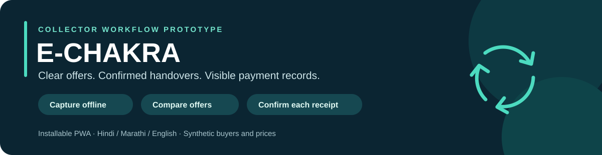

# E-CHAKRA



**A mobile-first prototype helping informal collectors record e-waste lots, compare buyer offers, confirm handovers and track payment receipts.**

**Smart India Hackathon 2026 · The Optimist · Team 135129**  
**PS reference in the team's presentation: 26229 — Kabadiwala Connect.** The issued PS text, organisation and exact portal identifier still need official confirmation; see [problem statement and provenance](docs/problem-statement.md).

[Judge's guide](docs/judge-guide.md) · [Run locally](docs/setup.md) · [Demonstration](docs/demo.md) · [Requirements](docs/requirements.md) · [Architecture](docs/system-architecture.md) · [Test evidence](docs/testing.md)

[](https://github.com/kartiksingh6734/E-Chakra-/actions/workflows/verify.yml)

## Start reviewing

| Your question | Open this |
| --- | --- |
| Does it address the stated problem? | [Problem and scope](docs/problem-statement.md), then the [feature-to-evidence matrix](docs/requirements.md) |
| What can I try? | [Demo with synthetic inputs](docs/demo.md) |
| Where is the working code? | [Application](prototype/), [workflow rules](prototype/lib/domain.ts), [API](prototype/app/api/ec/route.ts) |
| Can I reproduce it? | [Setup](docs/setup.md), [verification commands and results](docs/testing.md) |
| What is incomplete? | [Limitations and roadmap](docs/limitations.md) |
| What supports feasibility and impact? | [Feasibility](docs/feasibility.md), [field validation plan](docs/validation-plan.md), [references](docs/references.md) |

## Current prototype

The core journey is **create lot → compare offers → agree handover → confirm payment → keep records**. The interface supports Hindi, Marathi and English. Local drafts can retain photos and voice recordings; the app attempts foreground synchronisation when connectivity returns.

| Available in this build | Boundary |
| --- | --- |
| IndexedDB draft queue, PWA manifest and service worker | Open online first; actual Android offline/reload acceptance is pending |
| Persistent lot records and private photo/audio storage | Hosted demo uses one account's private workspace |
| Offer comparison, transport deductions and expiry checks | Buyer names, distances and rates are synthetic |
| Proposed handover terms and collector confirmation | Recycler role switching simulates the counterparty |
| Partial payments, receipt confirmation, receipts and CSV export | Records external cash/UPI payments; does not transfer money |
| Issue reporting | Freezes the transaction; staff resolution is not implemented |

Manual category selection and simple eligibility rules are implemented. **Trained AI, live market prices, verified recycler onboarding, independent participant accounts, reward payouts and measured field impact remain future work.** See the [status matrix](docs/requirements.md).

## Try it

[Hosted prototype](https://e-chakra-collector.kartiksingh6734.chatgpt.site) — owner-private; reviewers need a maintainer-led session. An account access prompt is not a public demo login. Local development needs no cloud account or API key.

```bash
git clone https://github.com/kartiksingh6734/E-Chakra-.git
cd E-Chakra-/prototype
# Use Node.js 24 and pnpm 11.25.0; see the setup guide.
pnpm install --frozen-lockfile
pnpm run build
pnpm run db:local
pnpm run dev
```

Open `http://localhost:5173`. Follow the [demo guide](docs/demo.md); no customer data is required. `pnpm run verify` checks documentation links, TypeScript, domain tests, the production build and the API using an isolated local database.

## Technical choice

**React + TypeScript + Tailwind → Worker API through Vinext → D1 SQLite and R2**, with **IndexedDB + Cache Storage** on the device. This prototype uses D1/Worker in place of the presentation's PostgreSQL/Express proposal. The [architecture](docs/system-architecture.md) explains the decision and planned ML boundary.

## Evidence and ownership

Executable tests and dated [verification evidence](docs/testing.md) are included. Browser installation, accessibility, camera/microphone and real-device offline checks remain open. Presentation price comparisons are illustrative until supported; they are not measured income gains.

See [team and credits](docs/team-and-credits.md), [contributing](CONTRIBUTING.md), and [security](SECURITY.md). Use synthetic data for demonstrations and issues. A handover receipt is a transaction record, not proof of completed recycling or an EPR certificate.
