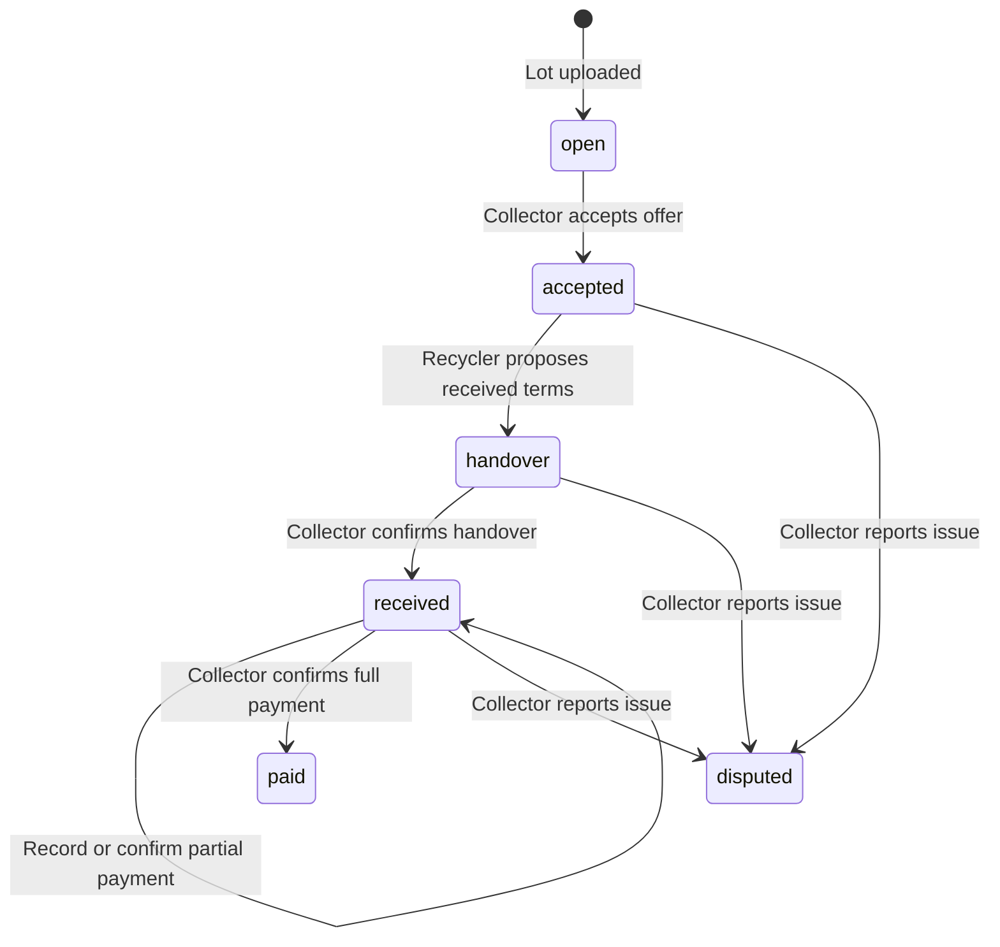

# Implemented collector workflow

[Home](../README.md) · [Demo inputs](demo.md) · [Domain code](../prototype/lib/domain.ts)

Collector and recycler controls share one owner's private workspace. They demonstrate an exchange without authenticating two independent businesses.

Local drafts are outside this server state machine. A queued draft becomes `open` after upload. `received` means handover acknowledged, not fully paid. `disputed` has no resolution transition in this build.

## Collector journey

1. **Capture:** manually choose category/condition, enter quantity/location, optionally attach photo/voice. Save locally before upload.
2. **Compare:** add sample offers or enter a quote in recycler demo mode. Compare rate, transport charge, net amount, pickup label and expiry.
3. **Accept:** select a current offer online. Preserve its terms with the lot.
4. **Review handover:** recycler demo proposes measured quantity, final amount and location; collector confirms or reports an issue.
5. **Confirm money:** recycler demo records cash or an external UPI reference; collector separately confirms receipt. Partial receipts leave a balance.
6. **Keep records:** download a text receipt or CSV ledger. Neither is a recycling certificate.

## Exceptions and scope

| Situation | Current behaviour |
| --- | --- |
| Offline capture | Draft/media waits for foreground sync; device acceptance pending |
| Duplicate upload | Existing owner/lot record returned |
| Expired offer | Acceptance rejected |
| Stale update | HTTP 409; refresh and retry |
| Changed final terms | Require collector confirmation; no automatic settlement |
| Partial payment | Only confirmed receipts reduce balance |
| Overpayment claim | Rejected |
| Reported issue | Disputed state blocks further transaction changes |
| Partial rejection | No remaining-quantity ledger or lot split |
| Offline handover/payment | Not available |
| Cancellation / dispute resolution | Not implemented |
| Aggregation / referral payout | Not implemented |

Transport and buyer eligibility data are synthetic. Pickup scheduling and official recipient verification are [pilot requirements](limitations.md).
