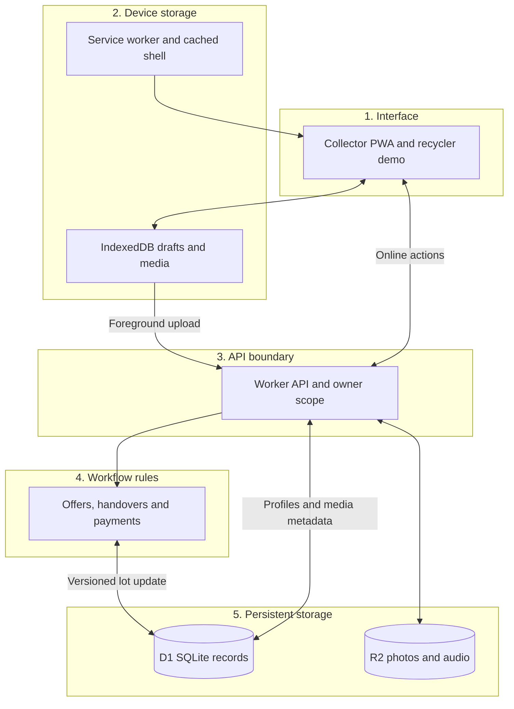
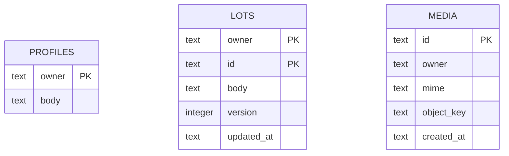

# Implemented system architecture

[Home](../README.md) · [Workflow](collector-workflow.md) · [API](api.md) · [Security](../SECURITY.md)

One responsive application and one Worker API support the prototype. These five layers describe responsibilities, not five independently deployed services. Solid connections are implemented paths. Planned integrations are listed separately.

The diagram and database model below describe the original Sites deployment. The [standalone Cloudflare option](cloudflare-deployment.md) reuses the interface, [collector service](../prototype/lib/collector-api.ts) and domain rules, with [browser-session authentication](../prototype/cloudflare/session.ts) and [capped D1 attachment storage](../prototype/cloudflare/media.ts). Its [separate schema](../prototype/cloudflare/migrations/0001_demo.sql) adds sessions and media chunks with cascading expiry cleanup; no R2 binding is required.

## Components

| Component | Implementation | Purpose |
| --- | --- | --- |
| Interface | [React/TypeScript](../prototype/app/collector-app.tsx), [Tailwind/CSS](../prototype/app/globals.css) | Responsive interface and three-language copy |
| Offline storage | [IndexedDB](../prototype/lib/offline.ts) | Persist drafts and attachment blobs before upload |
| App shell | [Service worker](../prototype/public/sw.js), [manifest](../prototype/public/manifest.webmanifest) | Cache shell/assets and expose installation metadata |
| API | [Vinext routes](../prototype/app/api/ec/route.ts) on a Worker | One server surface with validated inputs |
| Rules | [TypeScript domain](../prototype/lib/domain.ts) | Test transitions, expiry and financial invariants separately |
| Structured records | [D1 schema](../prototype/db/schema.ts), [Drizzle migrations](../prototype/drizzle/) | Scoped lot JSON, versions, profiles and attachment metadata |
| Media | [R2 API](../prototype/app/api/media/route.ts) | Private binary objects outside database documents |
| Identity | [ownerOf](../prototype/lib/server.ts) | Trusted hosted owner identity; local development fallback |

## Database model

`lots.body` contains offers, an accepted-offer reference, handover, payments, events and recent operation IDs. Owner relationships and optional attachment references are checked in application code; these tables have no declared SQL foreign keys between them. R2 stores binary objects. A normalized transaction model remains a future migration choice.

## Transaction consistency

- Lot creation is idempotent on `(owner, id)`.
- Mutations carry the last known version and an operation ID. An owner/id/version SQL condition rejects stale writes with HTTP 409.
- The last 256 mutation IDs are retained: bounded retry detection, not a permanent deduplication ledger.
- Handover proposal, collector acknowledgement, payment claim and payment acknowledgement are distinct. Only confirmed receipts reduce dues.
- Each lot update is atomic. R2 upload and D1 metadata insertion are separate; failed metadata insertion triggers object cleanup, not a distributed transaction.

## Offline boundary

Open online once. Draft capture, cached records and local media can then be available offline. Publishing, acceptance, handover confirmation, profile updates and payments require a server response. Sync runs on startup, reconnection, manual request and periodic foreground retries; there is no closed-app background sync.

API/auth routes are not cached by the service worker. IndexedDB is not encrypted and retains the last owner's cached scope. Offline reload, eviction and shared-device acceptance remain testing work. Use synthetic demo data.

## Difference from the presentation

| Presentation proposal | Current build | Decision / future gate |
| --- | --- | --- |
| React + Tailwind | React + TypeScript + Tailwind | Retained; packaged as a PWA |
| Node.js + Express | Worker routes through Vinext | One supported deployment; Node remains the build/development runtime |
| PostgreSQL | D1 SQLite | Bounded hosted persistence; migration/load design required before scale claims |
| FastAPI + Python ML | Not connected | Requires sourced data, baseline comparison and evaluated models |
| Google Maps | Text location and synthetic distances | No verified geolocation/routing |
| Razorpay | External-payment records only | Transfers and payment reconciliation remain separate work |

Independent authentication, checked buyer onboarding and operational dispute resolution must precede a real pilot. The diagram does not imply those are implemented.
